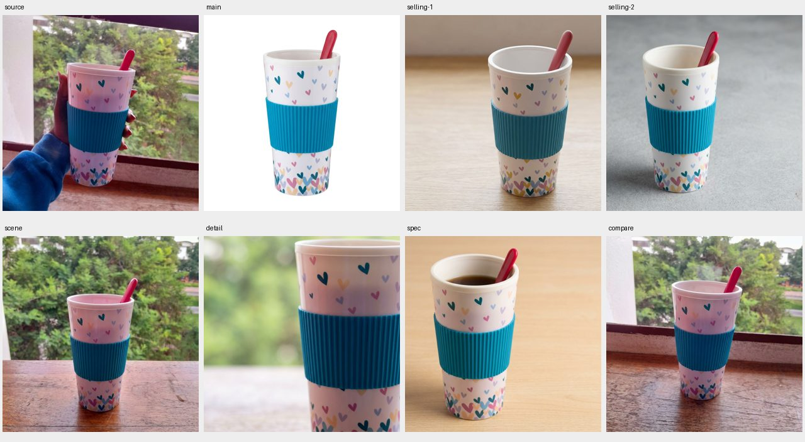
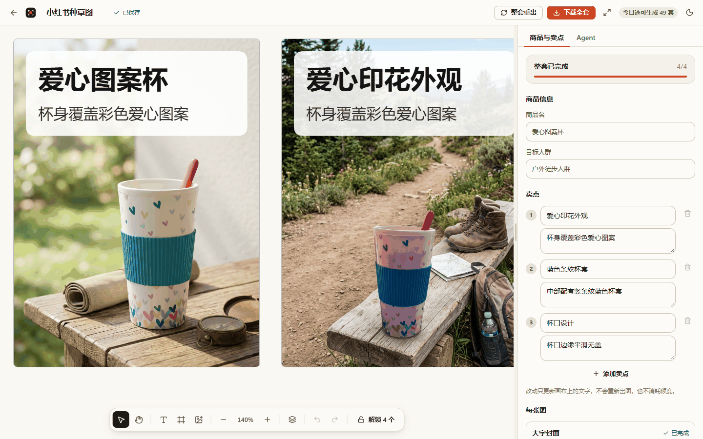
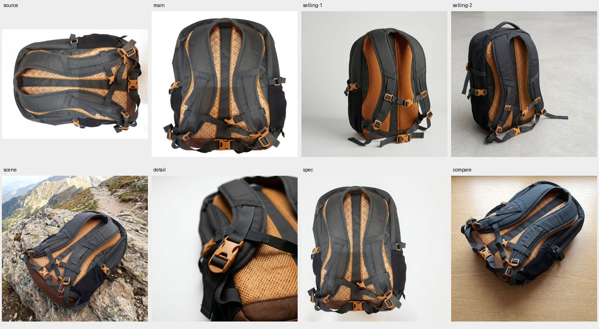

# 绘境 Huijing

上传一张商品图，选一个模板，一键生成一整套电商图。

在线演示：<https://huijing.airainyu.xyz>（免登录，每个 IP 每天 2 套）



## 它做什么

1. 拖入 1–3 张商品图，选模板（亚马逊 7 图、淘宝详情、小红书种草、单张快出），可以补一句话，也可以什么都不填。
2. 视觉模型先看图，识别商品并提炼 3–5 个卖点。
3. 按模板逐张出图：白底主图、卖点图、场景图、细节特写、规格图、对比图，每张都以原图为参考，保持是同一个商品。
4. 标题和卖点文字是画布上的**可编辑文字图层**，不让生图模型把字画进图里。改错字、换卖点只改图层，不用重新出图。
5. 单张重出、失败的几张重出、整套重出；下载 PNG/ZIP 时文字合成进图。

| 中文排版 | 导出效果 |
|---|---|
|  |  |



上面两组是真实运行结果，未挑选、未修图。测试商品图均为 CC0，来源见 [docs/showcase/SOURCES.md](docs/showcase/SOURCES.md)。

## 已知局限

- 商品一致性靠参考图约束，细小结构（扣具位置、印花分布）仍会漂移，需要单张重出。
- 场景图有时会贴近原图构图。
- Vertex 图片配额紧时会排队重试，一套 7 张约 6–8 分钟；超过等待上限的单张标为限流失败并退还额度。

## 技术栈

- 前端：Next.js 静态导出 + Excalidraw 画布。
- 后端：Cloudflare Workers，D1 存项目与额度，R2 存图片，Durable Objects 负责画布协同与全站并发闸门，Queues 跑出图任务，Cron 恢复与清理。
- 模型：Gemini（Vertex AI）。`gemini-3.1-flash-image` 出图，`gemini-3.1-flash-lite` 分析商品。
- 模板是 `packages/shared/src/set-templates.ts` 里的数据，增删模板不改业务代码；文字排版 token 在 `packages/shared/src/text-styles.ts`，前后端共用。

```
apps/web        Next.js 前端
apps/edge       Cloudflare Worker（API、Durable Objects、Queue 消费）
packages/shared 前后端共享的 zod 契约、模板与排版 token
scripts         部署与开源检查脚本
```

## 本地运行

需要 Node.js 24、pnpm 10。

```bash
pnpm install
cp apps/edge/.dev.vars.example apps/edge/.dev.vars   # 至少填 32 字符的 SESSION_SECRET
pnpm --filter @loomic/shared build
pnpm --filter @loomic/web build
(cd apps/edge && pnpm exec wrangler d1 migrations apply huijing-dev --local)
pnpm dev:edge                       # http://localhost:8787，前端与 API 同源
```

默认用 fixture 模型，不需要任何密钥就能完整走一遍流程。要真实出图，在 `.dev.vars` 里设 `PROVIDER_MODE=vertex` 并填 `VERTEX_API_KEY`。前端热更新用 `pnpm --filter @loomic/web dev`。

检查：`pnpm -r typecheck && pnpm test:edge && pnpm --filter @loomic/web test`。

## 部署到自己的 Cloudflare

```bash
export CLOUDFLARE_API_TOKEN=...  CLOUDFLARE_ACCOUNT_ID=...
export VERTEX_API_KEY=...  SESSION_SECRET=$(openssl rand -base64 32)
pnpm run deploy:dry-run   # 纯本地演练
node scripts/deploy.mjs   # 创建/复用 D1、R2、Queue → 迁移 → 构建 → 部署 → 写 secret → 冒烟
```

API Token 需要 Workers Scripts、D1、Workers R2 Storage、Queues 的编辑权限；绑定自定义域名还需要对应 Zone 的 Workers Routes 权限。域名在 `apps/edge/wrangler.jsonc` 的 `env.production.routes` 修改。详见 [docs/部署.md](docs/部署.md)。

额度默认每 IP 每天 2 套、全站每天 150 张，在 `wrangler.jsonc` 的 `GUEST_DAILY_SETS`、`GLOBAL_DAILY_IMAGES` 调整。

## 致谢

本项目基于 [Loomic](https://github.com/fancyboi999/Loomic)（MIT）改造，保留其许可与版权声明。

## 许可

MIT，见 [LICENSE](LICENSE)。
